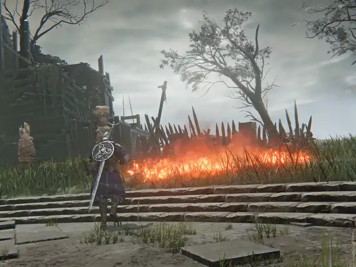
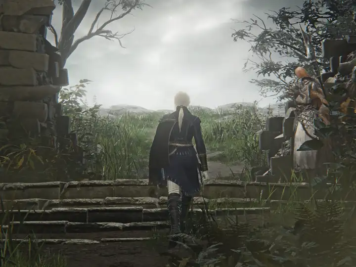
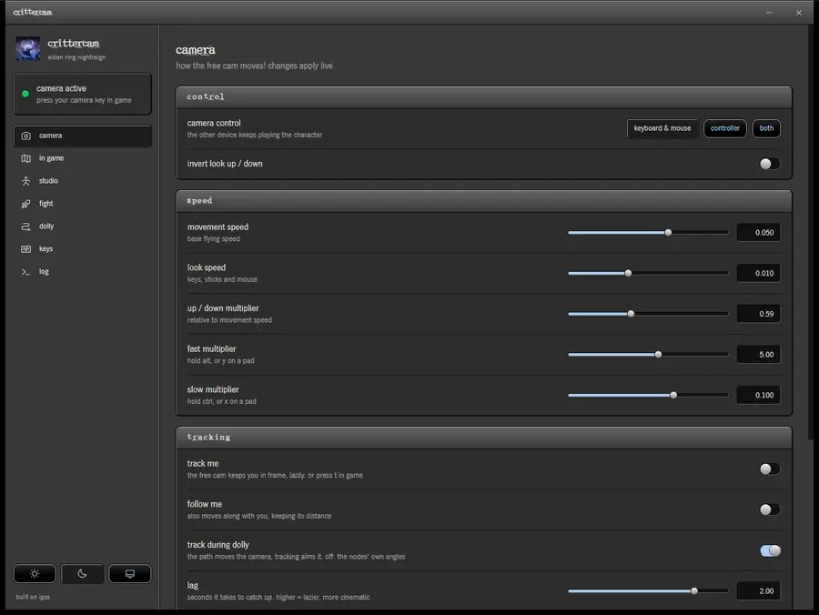
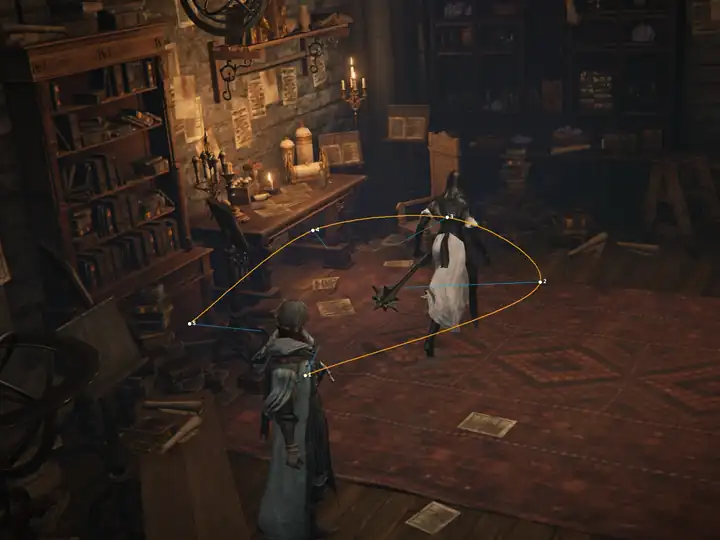
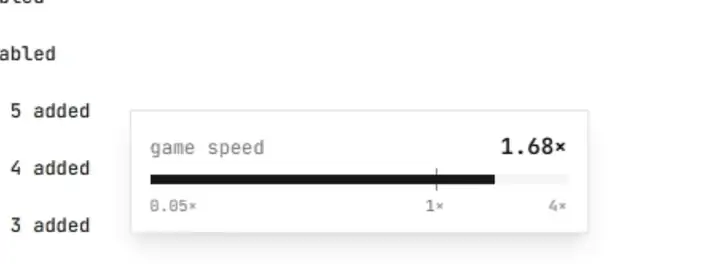
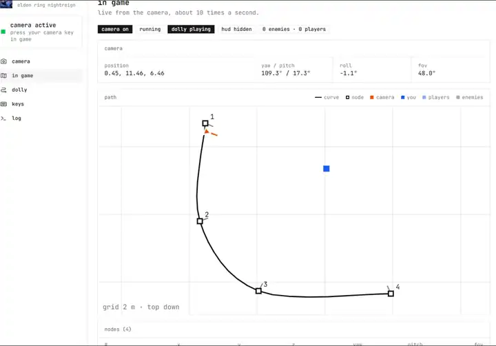

# crittercam

free cam, dolly paths, pause, game speed, hud toggle, live cam data, a gesture studio and a boss fight picker for **ELDEN RING NIGHTREIGN** (pc).




> offline only!! run the game with eac disabled (`steam_appid.txt` in the `Game` folder, start `nightreign.exe` directly). never use this online.
```

## build

1. open `crittercam.sln` in visual studio 2022 (needs the *desktop development with c++* workload).
2. set the toolbar to **release** / **x64**.
3. **build → build solution** (close the game first, it locks the dll).
4. output: `bin\x64\Release\crittercam.dll`.
5. app (tauri): `cd ui`, `npm install` once, then `npm run tauri dev` to run it, or `npm run release` to build `ui\src-tauri\target\release\crittercam.exe`.

## updates


ship a version: `.\ship.ps1 0.2.0 "what changed"` (game closed). it builds the dll and the installer, signs it, and creates release `v0.2.0` with the installer and `latest.json`. commit the version bump afterwards.


## use



1. start nightreign offline (eac disabled) and load in.
2. run the crittercam app and click **inject camera**. keep it open, it's where settings and keys live.
3. press **insert** to enable the camera.



| key | action |
|---|---|
| insert | camera on / off |
| w / s / a / d | move forward / back / left / right |
| r / f | move up / down |
| arrow keys, or mouse | rotate |
| z / x | tilt left / right |
| page up / page down / home, or mouse wheel | zoom in / out / reset |
| alt / ctrl (hold) | faster / slower |
| pause | pause / unpause |
| end | skip a few frames while paused |
| shift + mouse wheel | game speed -/+ 0.1 (eased, the app shows it) |
| ctrl + mouse wheel | dolly seconds per node -/+ 0.5 |
| delete | hide / show all ui (hud, talk boxes, subtitles, menus), also hides the dolly path |
| backspace | block game input (on by default while the camera is on) |
| scroll lock | lock camera movement |
| **f5** | dolly: add node at the camera |
| **f6** | dolly: play / stop |
| **f7** | dolly: delete last node |
| **f8** | dolly: clear path |
| **f9** | cycle camera target |
| t | track me on / off |

while the free cam is on, a controller moves your character relative to the free cam, not the game camera.

while the free cam is on, the dolly path is drawn over the game: orange curve, numbered nodes, cyan line = where each node looks. needs **borderless windowed** (or windowed) display mode.



**tracking:** press t (or the switch on the camera page) and the free cam keeps you in frame with a cinematic lag, starting from the shot you have. turn on **follow me** and it also moves along, keeping its distance. the **lag** slider sets how lazy it is. with **track during dolly** on (the default), it also works during dolly playback: the path moves the camera, tracking aims it.

**game speed:** hold shift and scroll in game (or use the slider on the camera page). the app pops up a speed meter while it changes.



**in game tab:** live camera position, angles and fov, your dolly nodes, and a top-down map of the path, you, players and enemies.



dolly timing (seconds per node) and looping are on the app's dolly page. all keys can be rebound in the app.

**dolly instructions:** pause (pause), enable camera, fly to a spot, f5, fly to the next spot, f5 … then f6.

## studio

for recording your own character.

- **gestures:** all 55 gestures by name (wave, bow, prayer, crossed legs …). each plays once, then you're back to standing. sitting ones stay seated until **stop**. the **any animation** box plays any behavior event, like `W_Event80010`.
- **no gravity:** your character stays where it is, gestures still play.
- **move up / down:** lift your character off the floor, in steps from 0.25 m to 5 m.
- **invincible:** hits still land, but your hp stays full.
- **enemies ignore you:** enemies stay alive and moving, but don't target you and their hits do nothing. turn it off to give them their teams back.

**greenscreen:** use reshade with fubax `Chromakey.fx` (depth based). turn on no gravity and lift your character a bit, so the floor is behind the key distance and only your character is left.

## boss fights

the **fight** page starts any of 144 fights (bosses, nightlords and more, with search) with one click.

it needs the [nightreign boss arena](https://www.nexusmods.com/eldenringnightreign/mods/449) mod (3.1.13) and the [me3](https://github.com/garyttierney/me3) mod launcher:

1. install me3 and unpack the boss arena mod.
2. launch the game with the mod's sandbox profile (`Launch NR Boss Arena (Sandbox).me3`), still offline / eac disabled.
3. inject crittercam, stand in the roundtable hold, and click **fight** next to a boss. the mod warps you into its arena.

the page also has an **any event flag** box to check / set / clear any event flag by id.

## project layout

| path | what |
|---|---|
| `CameraDll/` | the injected dll (c++ / masm) |
| `CameraDll/GameConstants.h` | game specific offsets and keys |
| `CameraDll/InterceptorHelper.cpp` | byte patterns + hooks |
| `CameraDll/Interceptor.asm` | the hook code that runs inside the game |
| `CameraDll/CameraManipulator.cpp` | writes our camera into the game, pause |
| `CameraDll/Camera.cpp` | free camera math |
| `CameraDll/CameraPath.cpp` | dolly paths |
| `CameraDll/Studio.cpp` | gestures, no gravity, invincible, enemies ignore you, event flags |
| `ui/` | app: injector, settings, in game, studio, fight pages (tauri: react/typescript + rust) |
| `ui/src/fights.ts` | the boss arena fight list |
| `IGCSClient/` | old client (c# / wpf), replaced by `ui/` |
| `dependencies/` | minhook |
| `docs/NightreignAOBs.h` | notes on every pattern and offset, and how each was found |
| `docs/refmat/` | reference lists from the soulsmodding wiki |
